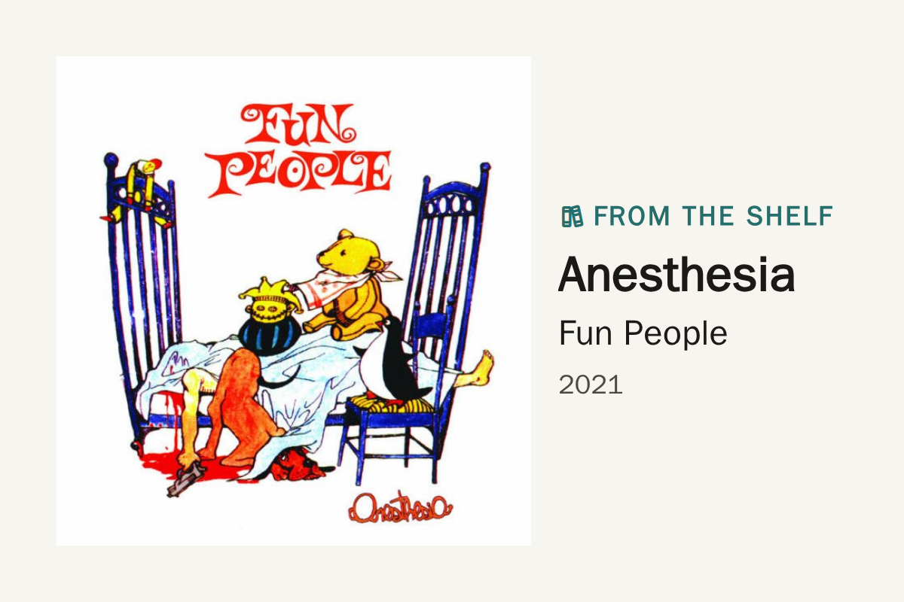

# plexamp_now_playing

Tesserae widget: cover, album and artist for one
[Plexamp](https://www.plex.tv/plexamp/) player (matched by name, e.g. a
headless [Caldera](https://caldera.homes/music/) player called `caldera`),
read straight from Plex
`/status/sessions`. No Home Assistant needed. When nothing is playing it shows
a random album from the music library ("From the shelf").

## Install

From the catalog: **Settings → Widgets → Browse**, search *Plexamp, Now
Playing*.

By hand: copy this folder to Tesserae's `authored/plexamp_now_playing/` (in
the data dir; `plugins/<id>/` there is only the widget's data dir) and
restart.

Then **Widgets → Plexamp, Now Playing**: set the Plex URL and the server
owner's `X-Plex-Token` (an owner token is needed to see every session). The
token stays on the server: cover art is fetched server-side and inlined.

## Network and data

The widget only talks to the Plex server you configure:
`/status/sessions`, `/library/sections` and the album listing, and
`/photo/:/transcode` for cover art (the token goes along as a header and in
that URL's query, to your own server). Covers are cached in the widget's own
data dir. Nothing else is read or written.

## Why it is shaped this way (battery panels)

- The random album is seeded by a time bucket (`shelf_hours`, default 6), so
  every render in that window is byte-identical → same ETag → the panel gets
  a `304` and doesn't repaint.
- Track title is off by default: the frame changes once per album, not per song.
- The label reads "Now playing" for both playing and paused, so pausing
  doesn't trigger a repaint.
- While a track plays, the widget returns `next_change_at` = just after that
  track ends (clamped to 1–10 min), which pulls the panel's next wake in.
  Idle or paused it returns nothing, so the panel sleeps its full device
  interval: set that long (e.g. 1 h) and the panel barely wakes when no music
  is on. A button tap still checks immediately.

## Fragments (layouts)

| Fragment | |
|---|---|
| `full` | cover left, big text right (portrait: cover top) |
| `poster` | cover full-bleed (centre-cropped to the cell), solid caption band at the bottom |
| `gallery` | whole square cover, uncropped; label + year above, album — artist below |
| `overlay` | cover fills the panel (~12 % cropped top and bottom), one small white caption (hard black shadow) bottom right |
| `cover` | cover only |

On a grid dashboard (where cells are always `full`) pick the layout with the
`layout` cell option instead; on a Panels canvas the Part picker wins.

The manifest sets `render.full_bleed`, so the page gap doesn't inset this
widget at the panel edge (`full` keeps its own inner padding).

Captions sit on solid bands, never gradients — a gradient over a photo dithers
to noise on a few-ink panel.

## Cell options

| Option | Default | |
|---|---|---|
| `layout` | full | `full` / `poster` / `gallery` / `overlay` (grid dashboards) |
| `player` | blank | substring of Player title/product/machine id; blank = any |
| `include_paused` | true | keep the album up while paused |
| `show_track` | false | adds the track line (more repaints) |
| `shelf_hours` | 6 | how often the idle cover rotates |
| `section` | all | music library name or id |
| `tone` | color | `mono` = greyscale + autocontrast before quantising |

## Credits

Derived from [plex_recently_added](https://github.com/dmellok/tesserae-widget-plex-recently-added)
(AGPL-3.0).
